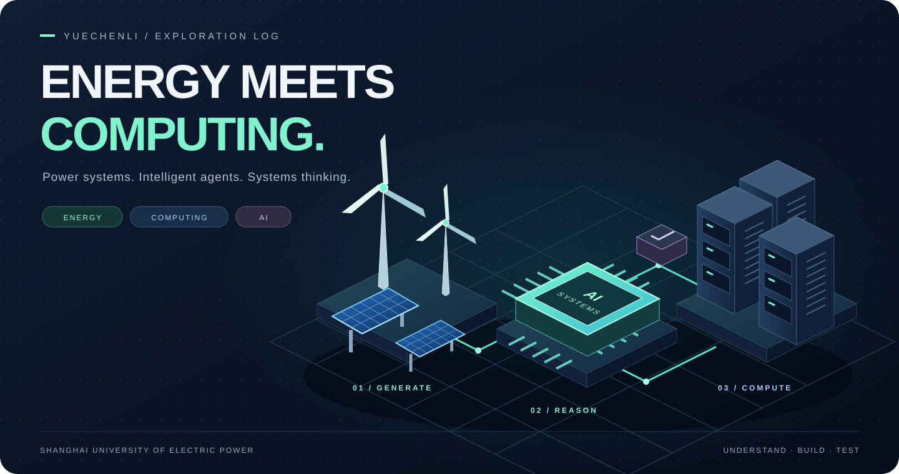

  

  <h2>Hi there! 👋 I'm YueChenLi 🐹</h2>

  <b>Data Science @ SUEP · AI Agents · Energy Informatics · Reliable Systems</b>

  
<i>Exploring how intelligent decisions become dependable real-world systems.</i>

  

    
    
    
    
  

## 🎓 About Me

I'm a **2024-cohort undergraduate student majoring in Data Science and Big Data Technology at Shanghai University of Electric Power (SUEP), China.**

I build and study software at the intersection of **AI agents, energy and electric-power applications, and computer systems**. My projects range from constrained energy planning and domain-aware robot interactions to Linux scheduling experiments, scientific retrieval, and developer tools.

What connects them is a recurring question: **How do we turn an intelligent idea into a system that can be understood, tested, constrained, and trusted?**

I prefer to understand a mechanism, build a working prototype, and verify its behavior with reproducible experiments. I'm especially interested in architectures where language models propose and interpret, while deterministic tools, explicit state, validation, and human oversight define what is actually allowed to happen.

**Understand the mechanism. Build the system. Test the assumptions.**

## 🧭 What I Work On

| Direction | Questions and technologies |
| :--- | :--- |
| ⚡ **Energy Informatics** | Integrated energy planning, constrained optimization, economic and emissions trade-offs, robust decisions |
| 🤖 **AI Agents & Robotics** | LangGraph-style stateful workflows, structured tool interfaces, domain semantics, robot mission orchestration, safe fallback |
| 💻 **Computer Systems** | Linux, process and thread scheduling, concurrency, state machines, fault recovery, testable software architecture |
| 🔎 **Data & AI Foundations** | Semantic retrieval, embeddings, machine learning, optimization, and training dynamics |

These are connected interests, not claims that every area is equally mature or production-deployed.

## 🚀 Selected Projects

| Project | What it demonstrates |
| :--- | :--- |
| ⚡ **[Regional Energy Agent](https://github.com/YueChenLi-lab/regional_energy_agent)** | A constrained electricity–heat planning prototype combining deterministic optimization, an agent-facing workflow, independent numerical checks, counterfactual feasibility repair, and minimax-regret scenario comparison. The repository currently documents **v0.5.0**, including a decision workbench and validation evidence. |
| 🤖 **[Power Inspection Robot](https://github.com/YueChenLi-lab/power-inspection-robot)** | My software focus in a team robotics project: power-domain speech/semantic understanding, evidence-preserving structured mission drafts, safety validation, and a **single-machine Mock InspectionOS** for mission lifecycle, scheduling, approval, and recovery. The public prototype is **not yet integrated with real equipment**. |
| 📚 **[arXiv Fetcher](https://github.com/YueChenLi-lab/arxiv_fetcher)** | An AI-paper retrieval system using the arXiv API, staged ingestion, ChromaDB, embeddings, and semantic search, with a separate data-building workflow and API layer. |
| 🧪 **[Linux Process Management Extensions](https://github.com/YueChenLi-lab/linux-process-management-extensions)** | Reproducible C/Python experiments: PCB queue invariants, FCFS/SJF/RR comparisons on common workloads, and real Linux nice-priority measurements with controlled CPU contention and preserved raw evidence. |
| 🎨 **[RenderKit 2D](https://github.com/YueChenLi-lab/RenderKit-2D-AI-Native-Visual-Rendering-Framework)** | An early-stage TypeScript framework for turning structured content into Web and editable PPTX outputs, with a shared semantic representation, layout constraints, auditing, and deterministic repair. |
| 🌱 **[Carbon Platform](https://github.com/YueChenLi-lab/carbon-platform)** | A construction-waste and carbon-data application extended with a modular LangGraph/DeepSeek multi-agent **prototype**. The repository documents remaining end-to-end integration limits. |

### Other Engineering Explorations

- **[Linux Thread Mechanism Lab](https://github.com/YueChenLi-lab/linux-thread-mechanism-lab)** — POSIX threads, synchronization, contention, and tracing.
- **[Social Network Analysis](https://github.com/YueChenLi-lab/SocilaNetwork)** — Java graph algorithms and browser-based relationship visualization.
- **[Linux 0.11 Scheduling Lab](https://github.com/YueChenLi-lab/linux011-process-scheduling-lab)** — operating-system process scheduling and tracing exercises.
- **[MinOS](https://github.com/YueChenLi-lab/MinOS)** — a source backup for ongoing operating-system exploration; not a finished OS release.

## 🔬 What I'm Learning & Researching

**Stateful and reliable agents.** I'm studying agent execution models, graph-based orchestration, state updates, persistence, error handling, retrieval, and the boundary between LLM-generated suggestions and authorized actions. I also read frameworks such as [LangGraph](https://github.com/langchain-ai/langgraph) to understand their engineering choices rather than treating a framework fork as my own original implementation.

**Energy and embodied applications.** I'm interested in what it takes to add natural-language interaction and domain intelligence to mature engineering systems **without replacing their existing control, safety, or verification layers**.

**Machine learning foundations.** I'm working through the mathematics behind optimization, representation learning, and neural-network training dynamics, with an emphasis on connecting theoretical claims to experiments.

**My engineering bias:** preserve the baseline, introduce capabilities behind clear interfaces, test failure cases, keep evidence, and distinguish simulation from real-world deployment.

## 💖 A Little More About Me

  
  
<i>Behind the systems and circuits: still a hamster at a laptop. 🐹</i>

- ✍️ Fanfiction writer, occasionally a programmer.
- 🇹🇭 Hopelessly addicted to Thai dramas.
- 💙❤️ **BKPP enthusiast.** Yes, I'm emotionally invested.
- 📖 Proud AO3 wanderer. My reading history is between me and the universe.
- 🐹 A patterned hamster who might occasionally uproot a willow tree.
- 💻 I write code to survive, and fanfiction to stay alive.

**CODE IS WORK. SHIPPING IS LIFE. PERIOD.** 💅

*My code may have bugs, but my ships deserve a happy ending.*

**Research by day, AO3 by night.** 🌙

## 📊 GitHub Activity

  

---

  <i>Curiosity drives the questions. Persistence builds the answers.</i>
  
Thanks for visiting! 🐹💖

