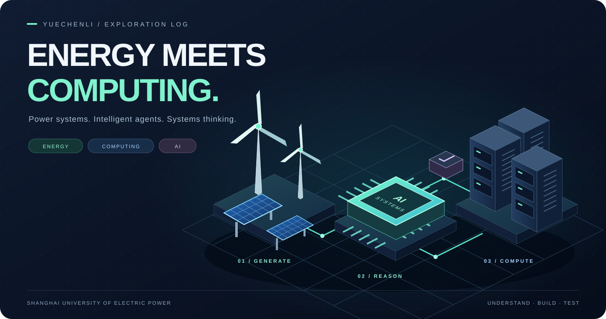

  

  <h2>Hi there! 👋 I'm YueChenLi 🐹</h2>

  <b>Data Science @ SUEP · Energy Informatics · AI & Computer Systems</b>

  
<i>Exploring how energy systems and intelligent computation work together.</i>

  

    
    
    
    
  

## 🎓 About Me

I'm a **2024-cohort undergraduate student majoring in Data Science and Big Data Technology at Shanghai University of Electric Power (SUEP), China.**

My interests sit at the intersection of **energy and electric power**, **computer systems**, and **artificial intelligence**. I'm exploring how optimization and intelligent agents can support energy planning and power inspection—and how operating systems, concurrency, and reliable software make those ideas practical.

I like starting with a question, digging into the principles, designing an experiment, and seeing what reality has to say.

For me, theory and engineering belong together: **understand the mechanism, build the system, and test the assumptions.**

## ⚡ Energy × Computing × Intelligence

| ⚡ Energy & Electric Power | 💻 Computer Systems | 🧠 Artificial Intelligence |
| :--- | :--- | :--- |
| Integrated energy planning | Linux & operating systems | LLM agents & multi-agent systems |
| Constrained optimization | Threads, synchronization & scheduling | Model training & representation learning |
| Carbon data & emissions analysis | Graph algorithms & software architecture | Intelligent planning & decision support |
| Intelligent power inspection | Robot operating systems | Embodied AI & task orchestration |

**The connection I'm exploring:** energy problems give computation a purpose; computer systems give intelligent applications a foundation.

## 🔬 Research Interests

**⚡ Energy Informatics & Power Applications** 
Integrated Energy Systems · Energy Planning & Optimization · Carbon Analysis · Intelligent Power Inspection

**🧠 AI & Mathematical Foundations**  
Model Training Dynamics · Non-convex Optimization · Representation Learning · Machine Learning Theory

**⚙️ Computer Systems & Robotics**  
Operating Systems · **Robot Operating Systems** · Embodied AI · Robot Task Planning & Orchestration

**🤖 Intelligent Applications**  
LLM Agents · Multi-Agent Systems · Energy Informatics · Intelligent Power Inspection

I'm currently especially curious about *how neural networks learn over the course of training*, and *how operating-system ideas and intelligent agents can help robots behave more reliably*.

## 🚀 Selected Projects

| Focus | Project | What I'm building or exploring |
| --- | --- | --- |
| ⚡ Energy × AI | **[Regional Energy Agent](https://github.com/YueChenLi-lab/regional_energy_agent)** | Agent-assisted integrated energy planning with constrained optimization, economic evaluation, and emissions analysis. |
| 🌱 Carbon × Agents | **[Carbon Platform](https://github.com/YueChenLi-lab/carbon-platform)** | A construction-waste recycling and carbon-data platform, extended with a modular multi-agent decision-support prototype. |
| 🔌 Power × Data | **[Electrical Safety Analysis](https://github.com/YueChenLi-lab/electrical-safety-analysis)** | Exploratory machine-learning and data-analysis experiments for electrical safety and hazard detection. |
| 💻 Linux × Concurrency | **[Linux Thread Mechanism Lab](https://github.com/YueChenLi-lab/linux-thread-mechanism-lab)** | Reproducible experiments with POSIX threads, mutex contention, futex tracing, and CPU scheduling. |
| 🕸️ Graphs × Algorithms | **[Social Network Analysis](https://github.com/YueChenLi-lab/SocilaNetwork)** | Java-based graph analysis and browser visualization, featuring BFS shortest paths and relationship exploration. |
| 🎮 Graphics × Interaction | **[Flappy Birds](https://github.com/YueChenLi-lab/flappybirds)** | A modular HTML5 Canvas game with custom rendering, collision detection, level progression, and in-game systems. |

## 🛠️ What I'm Exploring Beyond GitHub

I'm working on ideas for an **intelligent power-inspection robot**, focusing on domain-specific language understanding, safety-aware task planning, and modular software architecture. My interest is less about making a robot *look* intelligent and more about understanding how its decisions, tasks, and safeguards should fit together.

I also want to keep exploring **robot operating systems**, particularly the connections between operating-system design, embodied intelligence, and dependable robot software.

These are ongoing explorations—not claims of a finished robot OS or a deployed autonomous system.

## 💖 A Little More About Me

  
  
<i>Behind the systems and circuits: still a hamster at a laptop. 🐹</i>

- ✍️ Fanfiction writer, occasionally a programmer.
- 🇹🇭 Hopelessly addicted to Thai dramas.
- 💙❤️ **BKPP enthusiast.** Yes, I'm emotionally invested.
- 📖 Proud AO3 wanderer. My reading history is between me and the universe.
- 🐹 A patterned hamster who might occasionally uproot a willow tree.
- 💻 I write code to survive, and fanfiction to stay alive.

**CODE IS WORK. SHIPPING IS LIFE. PERIOD.** 💅

*My code may have bugs, but my ships deserve a happy ending.*

**Research by day, AO3 by night.** 🌙

## 📊 GitHub Activity

  

---

  <i>Curiosity drives the questions. Persistence builds the answers.</i>
  
Thanks for visiting! 🐹💖

